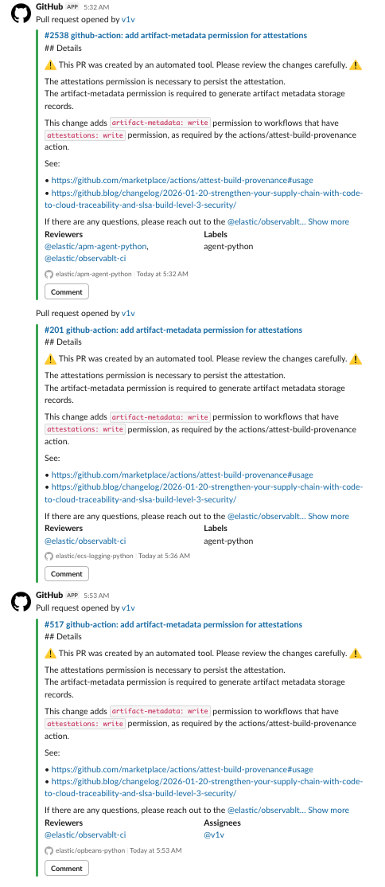
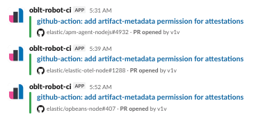

# slack-lite

GitHub PR notifications in Slack *on a diet*. **Skip notifications for dependabot PRs** (if you like), and

<details>
<summary>turn verbose notifications like these:</summary>



</details>

<details open>
<summary><strong>into more succinct notifications, like this:</strong></summary>



</details>


## Why slack-lite?

GitHub supports an [integration for Slack](https://slack.github.com/) with a number of features, including:
- Notifications for issues & PRs opening and closing, commits, releases, and deployments. Those are [the defaults](https://docs.github.com/en/integrations/how-tos/slack/customize-notifications), notifications for other GH events can be enabled.
- Link previews (e.g. post a GitHub issue URL and it'll add a preview/summary of the issue)
- Chatops-y things like commenting, opening issues, scheduling reminders directly from Slack.

The GitHub + Slack integration does **not** support:
- skipping notifications for events from specific users (like dependabot), or
- reducing the verbosity of notifications.

(The ability to skip some notifications based on user or label or whatever, specifically for dependabot, used to be the highest requested feature for the integration back [when it was open source](https://web.archive.org/web/20220823222940/https://github.com/integrations/slack/issues/951). The idea of using a GH Actions workflow for Slack notifications came from that thread, before it was deleted.)

At my work, I found that **conversation between humans** in Slack dev channels (those with GH notifications for a number of repos) **was getting drowned out** by GitHub notifications. Want to see what co-workers in another time zone were discussing last night? You need to scroll back through pages of PRs, many of them from bots like dependabot. It really broke up natural conversation.

**"Slack-lite" is an 80/20% solution to reduce the volume and size of GitHub issue/PR notifications** so that a Slack channel can have meaningful *conversation* without getting drowned out.

## I still use the GitHub + Slack integration

Note: I still use the GitHub + Slack integration for **some things**:

- Notifications for GitHub "releases", because the slack-lite "Prepare Slack message" step doesn't know about GitHub release events. I haven't bothered.
- Link previews. Supporting link previews requires watching all messages in a Slack channel, which means deploying a [Slack App](https://docs.slack.dev/) which means infrastructure. Managing infra is added complexity that I didn't want. (Aside: It is possible managing infra could be avoided via Slack's [Deno Slack SDK](https://docs.slack.dev/tools/deno-slack-sdk/guides/deploying-to-slack). I haven't looked.)

This is why I say slack-lite is "an 80/20% solution".

## How slack-lite works

Slack-lite is a GitHub Actions workflow that you put in each of the repositories from which you want notifications. Copy the template file from here, fill in a few details, and add to your repository. (Yes, I could probably create a re-usable GitHub Action, but I haven't done so.) Because it is a workflow in *your* repo, you can configure it how you like.

1. The workflow runs on issue and pull-request (PR) events, e.g.:

    ```yaml
    on:
      issues:
        types: [opened, reopened, closed]
      pull_request_target:
        types: [opened, ready_for_review, reopened, closed]
    ```

2. It uses some inline Python code to massage the GitHub event JSON into a nice-enough Slack notification (a payload for the [Slack `chat.postMessage` API](https://docs.slack.dev/reference/methods/chat.postMessage/)):
    https://github.com/trentm/slack-lite/blob/d120621bfa176928636e01d6139b69afd1e4e2db/slack-lite.template.yml#L40-L122

3. It uses Slack's [`slackapi/slack-github-action`](https://github.com/slackapi/slack-github-action) to send the message.


## How to setup slack-lite

1. Copy the [template workflow file](./slack-lite.template.yml) to ".github/workflows/slack-lite.yml" (or whatever workflow name you like) in your repository.

2. Configuration (see "TODO" comments in the template):

    - Set the `SLACK_CHANNEL` value to your channel name.
    - Add a `SLACK_BOT_TOKEN` secret to your repo. This is the "Bot User OAuth Token" from the "OAuth & Permissions" section of your Slack App (https://api.slack.com/apps). The token must have the `chat:write` permission.
    - Optionally tweak the `on:` and `if:` blocks in "slack-lite.yml" as desired.

    For example, here is the slack-lite.yml file in a repository I use at work: https://github.com/elastic/elastic-otel-node/blob/main/.github/workflows/slack-lite.yml

3. Configure the GitHub + Slack integration to *not* notify for some things:

    First, run this in your Slack channel. (Perhaps save this for later if you decide you *don't* want slack-lite and want to get your G+S integration config back.)

    ```
    /github subscribe list features
    ```

    This may show something like:

    ```
    Subscribed to the following repositories

    my-org/my-repo
    issues, pulls, commits, releases

    my-org/my-other-repo
    issues, pulls, commits, releases, deployments
    ```

    Now, unsubscribe from the notification you no longer need using `/github unsubscribe owner/repo [event]` (see https://docs.github.com/en/integrations/how-tos/slack/customize-notifications). For example:

    ```
    /github unsubscribe my-org/my-repo issues
    /github unsubscribe my-org/my-repo pulls
    /github unsubscribe my-org/my-repo commits

    /github unsubscribe my-org/my-other-repo issues
    /github unsubscribe my-org/my-other-repo pulls
    /github unsubscribe my-org/my-other-repo commits
    ```

    The repos that *I* work on all require a PR to merge to main, so I don't want notifications for "commits". You might be different.


## How to *unsetup* slack-lite

You've setup slack-lite and now you want to go back to the way you had it before.

1. Remove ".github/workflows/slack-lite.yml" from your repo.

2. Go to your Slack channel and re-subscribe each repo to the events you want notifications for (see https://docs.github.com/en/integrations/how-tos/slack/customize-notifications for docs). For example:

    ```
    /github subscribe my-org/my-repo issues
    /github subscribe my-org/my-repo pulls
    /github subscribe my-org/my-repo commits

    /github subscribe my-org/my-other-repo issues
    /github subscribe my-org/my-other-repo pulls
    /github subscribe my-org/my-other-repo commits
    ```

## Contributing

While contributions are great and I appreciate constructive feedback, please be aware that this is not a project I focus on. I likely won't be very responsive to issues and pull requests. Please feel free to fork and/or copy the workflow here and use as a template for your own needs.

## License

Copyright Elasticsearch B.V., Trent Mick<br>
SPDX-License-Identifier: Apache-2.0

